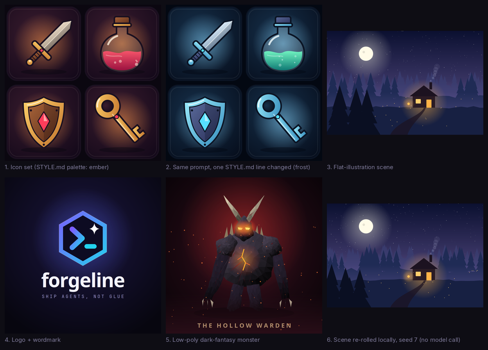
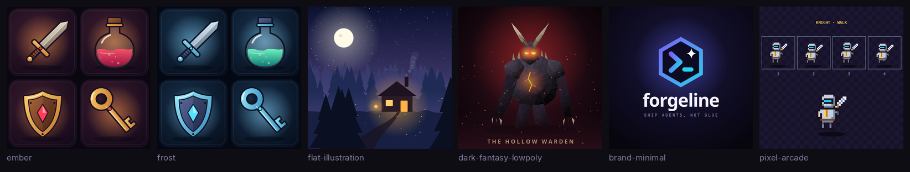

# Procgen Studio

**An image and video backend for [Hermes Agent](https://github.com/NousResearch/hermes-agent)
that draws with code.** Instead of calling a hosted image API, your configured model writes a
drawing program (SVG, or Python with Pillow/numpy), Procgen Studio renders it locally, and you
get back a PNG with the editable source and a reproducible seed saved right next to it.



Because it registers through Hermes's image-generation provider API, everything that already
calls the built-in `image_generate` tool (chat, cron jobs, messaging platforms, subagents) gets
it with no changes. Select it once and keep working.

## Why

- **No image API key, no per-image bill.** It uses the model Hermes already talks to, through
  the host-owned `ctx.llm` facade. Rendering is local and offline.
- **Editable.** Every image ships with the program that drew it. Change a number, re-render.
  Ask for an edit and the existing program is revised instead of rolling the dice again.
- **Consistent.** A `STYLE.md` art contract (palette, outline, lighting, shading, shape language)
  is injected into every generation, so an asset set looks like one set. Change one line and
  regenerate.
- **Reproducible.** Programs take their randomness from a seed. Re-rolling a seed re-runs the
  program locally in about a second, with no model call. Same program, same seed, same pixels.
- **Self-checking.** A critic reviews each render against the prompt and the style (by looking at
  the PNG when your model has vision, otherwise by reading the program plus measured facts about
  the image) and asks for a bounded number of redraws when it falls short.

It is built for icons, game assets, logos and wordmarks, flat illustrations and scenes, patterns
and textures, diagrams, low-poly creatures, pixel sprites and short motion graphics. It is not a
photorealism model.

## How it works

```
image_generate(prompt) ─▶ Procgen Studio provider
                            │ STYLE.md + preset + prompt directives ─▶ style contract
                            │ technique references picked for the request (icons, scene, logo, ...)
                            ▼
                          ctx.llm  ─▶  def draw(t): ... return svg     (your model writes this)
                            ▼
                          sandboxed render worker (separate process) ─▶ PNG
                            ▼
                          critic (vision or structure) ─▶ pass, or redraw with the issues (bounded)
                            ▼
                          PNG + source + seed + metadata ─▶ back to Hermes
```

Drawing programs see `W`, `H`, `SEED`, a seeded `rng`, the palette as `PAL[role]` and a few
helpers (`svg_doc`, `mix`, `shade`, `poly_pts`, `ease`, `pixel_grid`). They return an SVG string,
a Pillow image or a numpy array. Pixel art uses a palette-grid JSON spec instead of hand-placed
pixels, which is far more reliable.

## Install

Requirements: Hermes Agent 0.22.7 or newer, and the cairo system library that `cairosvg` uses
(preinstalled on most Linux desktops; `brew install cairo` on macOS; `apt install libcairo2` on
Debian/Ubuntu servers). Video needs `ffmpeg` on `PATH` (Hermes's installer ships one).

```bash
hermes plugins install iamlukethedev/hermes-procgen-studio --enable
hermes config set image_gen.provider procgen-studio
hermes config set video_gen.provider procgen-studio      # optional: animated output
hermes tools enable video_gen                            # optional: expose video_generate
```

The install asks for consent to add three Python dependencies: `cairosvg`, `numpy` and `Pillow`.
Or pick it interactively: `hermes tools` → Image Generation → **Procgen Studio**.

Then just ask:

```
> Make a set of 4 game icons on rounded tiles: a sword, a health potion, a shield and a key.
```

Check the setup any time with `hermes procgen status`.

## Configuration

Settings live under `plugins.entries.procgen-studio.settings` (they also render as a form in the
Desktop app under Settings → Plugins):

| Setting | Default | What it does |
|---|---|---|
| `preset` | `flat-illustration` | Style used when no STYLE.md applies |
| `style_file` | | A STYLE.md that applies everywhere |
| `critic` | `auto` | `auto` (vision, falling back to structure), `vision`, `structure`, `off` |
| `max_redraws` | `2` | Upper bound on extra model calls per image (repairs + critic redraws), 0-6 |
| `min_score` | `7` | Critic score (0-10) a render needs to pass |
| `allow_python` | `true` | Off restricts the model to literal SVG and pixel specs (no code runs) |
| `output_dir` | | Also copy every PNG + source + metadata into this folder |
| `render_timeout` | `90` | Seconds a drawing program may run |
| `time_budget` | `360` | Seconds per image; redraws stop early and the best attempt is returned (0 = no limit) |
| `llm_timeout`, `max_tokens` | `300`, `16000` | Per drawing call |
| `fps`, `video_seconds`, `gif` | `24`, `4`, `true` | Video defaults |

```bash
hermes config set plugins.entries.procgen-studio.settings.critic structure
hermes config set plugins.entries.procgen-studio.settings.output_dir ./assets/procgen
```

**Choosing models.** By default drawing and critique run on your main chat model. Procgen Studio
registers two auxiliary slots you can pin separately in `hermes model` → *Configure auxiliary
models* (or the Desktop Models page): **Procgen Studio drawing** (`procgen_draw`, a strong coding
model helps most) and **Procgen Studio critic** (`procgen_critic`, which follows Hermes's vision
slot until you pin it).

**Slow or local models.** Hermes stops any tool call after `timeouts.tools.sequential_call`
(420 s by default). Procgen Studio keeps each image inside `time_budget` by measuring its own
model calls and skipping redraws (or the critic) that would not fit, so you get the best attempt
instead of a timeout. For a slow local model raise both, for example
`hermes config set timeouts.tools.sequential_call 1800` and `time_budget 1700`.

The image model picker offers three tiers: `procgen-studio` (critic + up to `max_redraws`),
`procgen-fast` (no critic) and `procgen-careful` (3+ redraws, stricter pass score).

## STYLE.md

A STYLE.md is a few `key: value` lines plus optional prose. Procgen Studio uses, in order:

1. a `[style=<preset or path>]` directive in the prompt,
2. the `style_file` setting,
3. `./.procgen/STYLE.md` or `./STYLE.md` in the session's working directory (only if the file
   has a `preset:` or `palette:` line, so an unrelated writing-style guide is ignored),
4. your user style at `$HERMES_HOME/plugin-data/procgen-studio/STYLE.md`,
5. the preset picked with `/procgen style <name>`, then the `preset` setting.

```markdown
# STYLE.md - shared art contract
palette: ember
outline: 10px ink, round joins
lighting: top-left key light, soft rim on lower-right
shading: two-tone cel + one gradient, one specular highlight per object
background: rounded tile, radial vignette
```

- `preset: <name>` inherits every rule and colour from a built-in preset.
- `palette: <name>` takes the colours of a preset. This is the one-line restyle:
  `palette: ember` → `palette: frost`.
- `palette.<role>: #hex` overrides a single colour. Roles: `bg bg2 ink base base2 metal metal2
  accent accent2 wood wood2 liquid liquid2 gem glow highlight shadow sky sky2 ground foliage light`.
- Any other key (`outline`, `lighting`, `shape_language`, `typography`, ...) and free prose are
  passed to the model as rules.

`/procgen init ember` writes a starter STYLE.md into the working directory.

Because programs read colours from `PAL[role]`, a palette change can be applied **without a
model call**: `/procgen restyle --set dungeon-loot` re-renders the whole set locally. Rule changes
(lighting, outline weight, shape language) need a redraw: `/procgen regen --set dungeon-loot`.

## Presets



| Preset | For |
|---|---|
| `ember` | Warm cel-shaded game icons on dark rounded tiles |
| `frost` | The same rules with a cold palette (inherits `ember`) |
| `flat-illustration` | Layered flat vector scenes with atmospheric depth (default) |
| `dark-fantasy-lowpoly` | Faceted creatures and props with ember lighting |
| `brand-minimal` | Geometric marks, wordmarks and app icons with one gradient |
| `pixel-arcade` | 16-32 px sprites and sprite sheets via the pixel-grid spec |

## Prompt directives

Directives anywhere in a prompt are stripped before drawing:

| Directive | Effect |
|---|---|
| `[style=frost]` | Preset (or STYLE.md path) for this image only |
| `[seed=42]` | Fix the seed |
| `[set=dungeon-loot]` | Group renders into a set you can restyle or regenerate together |
| `[renderer=pixel]` / `[renderer=svg]` | Force an output format |
| `[critic=off]`, `[redraws=3]` | Override the critic loop for one call |
| `[size=800x600]` | Exact canvas size (otherwise 1536x1024 landscape, 1024x1024 square, 1024x1536 portrait; `resolution: 2K` doubles) |

The tool's `complexity` (-100..100) and `thinking` (`fast`/`high`) controls are honoured too.

## Commands

The same commands work in a session (`/procgen ...`) and in a terminal (`hermes procgen ...`):

| Command | |
|---|---|
| `status` | Style in effect, critic settings, ffmpeg, where renders live |
| `styles`, `style <preset>`, `style show`, `init [preset]` | Presets, the active contract, starter STYLE.md |
| `set <name>` / `set off` | Put the next generations into an asset set |
| `list [n] [--set s]`, `show <id\|last>`, `source <id\|last>` | Browse renders, paths, seeds, critic logs, code |
| `reroll <id\|last> [--seed n]` | Re-run the program with a new seed (local, free) |
| `restyle <id\|last\|--set s\|--all> [--style p]` | Re-render with the current palette (local, free) |
| `regen <id\|last\|--set s> [--style p]` | Redraw with the model under the current STYLE.md |
| `edit <id\|last> <instruction>` | Revise an existing drawing ("make the gem emerald green") |
| `render <file> [--seed n] [--style p] [--size WxH]` | Render a local `.py`, `.svg` or `.pixel.json` |
| `gallery [--set s]` | Contact sheet of recent renders |

Editing also works through the normal tool: pass a Procgen Studio image path as `image_url` with
an instruction and the existing program is revised. Any other image passed as `image_url` is
sent to your model as a composition reference.

## Video


With `video_gen.provider: procgen-studio`, `video_generate` asks for a `draw(t)` program that
animates over `t ∈ [0, 1]`, critiques a strip of three frames, renders every frame in the
sandbox and encodes MP4 (plus a GIF) with ffmpeg. Pass a Procgen Studio image as `image_url` to
animate an existing drawing. Supports 16:9, 9:16, 1:1, 4:3 and 3:4 at 480p-1080p, 1-15 s.

## Desktop pane

The package includes a Desktop half (`desktop/plugin.js` with routes in `dashboard/plugin_api.py`):
a **procgen** pane showing recent renders, the selected image with its prompt, seed, style and
critic score, its source code, and **Re-roll** / **Random** buttons that re-run the program locally.
A command palette entry re-rolls the latest render. Like every Desktop plugin half it ships opt-in:
enable it under Capabilities → Plugins.

Under `plugins.isolation: host` Hermes does not wire plugin terminal subcommands, so use
`/procgen ...` in a session instead of `hermes procgen ...`; everything else works the same.

## Limits

- **No blur.** cairosvg ignores SVG filters, so glows, halos, fog and soft shadows are built from
  radial/linear gradients fading to transparent (the prompts teach this).
- **Not photorealism.** Requests for photos come out as stylised illustrations.
- **Model-dependent.** The drawing is only as good as the model writing it. Strong coding models
  are what the gallery is aimed at; small local models produce much simpler drawings (see
  [`examples/local-model-check`](examples/local-model-check/README.md)), and the critic, the
  repair loop and the copy guard catch the worst failures.
- **Text** uses system fonts through font stacks (`Inter, DejaVu Sans, sans-serif`, ...), so exact
  typefaces depend on what is installed.
- **Pixel art** goes through the pixel-grid spec (`renderer=pixel`), which is reliable for sprites
  up to 128x128; freehand pixel placement in code was the weakest approach in testing.

## Security and disclosure

- **Network:** Procgen Studio makes no network calls of its own. Every model call goes through
  Hermes's `ctx.llm` on the provider you configured (or the `procgen_draw` / `procgen_critic`
  slots if you pin them). No telemetry.
- **Running model-written code:** Python drawing programs run in a **separate Python process**
  with an AST allowlist of imports (math, random, numpy, PIL and a few stdlib modules), no dunder
  or frame access, trimmed builtins, an audit hook that refuses sockets, subprocesses, process
  control, native library loading and any file read or write outside the job directory and the
  read-only interpreter/font folders, plus CPU, memory and file-size limits and a wall-clock
  timeout. This is defence in depth, not a security boundary. Set `allow_python: false` to accept
  only literal SVG (external references disabled) and pixel specs, which run no code at all.
- **Shell commands:** the video backend runs the system `ffmpeg` as a subprocess to encode frames.
  The render worker is started with the same Python interpreter Hermes uses.
- **Files read:** a `STYLE.md` in the session's working directory (only when it has a `preset:` or
  `palette:` line), your configured `style_file`, and images you pass as `image_url`.
- **Files written:** renders, sources and metadata under
  `$HERMES_HOME/plugin-data/procgen-studio/`, the published PNG/MP4 plus sidecars under
  `$HERMES_HOME/cache/generated/`, and your `output_dir` if you set one. `/procgen init` writes a
  STYLE.md into the working directory when you ask it to.
- **Credentials:** none. The plugin never sees a key; it declares no `requires_env`.
- **Background processes, self-updates:** none.

## Examples

See [`examples/`](examples/README.md) for every output above with its source, seed and metadata,
the prompts used, and how to regenerate the set with your own model (`bash scripts/e2e.sh`).

## Development

```bash
python3 -m pytest                                  # unit tests (render pipeline, sandbox, critic loop,
                                                   # seeds, provider contract, commands, Desktop routes)
hermes plugins validate . --install-deps           # catalog admission checks
ln -s "$PWD" ~/.hermes/plugins/procgen-studio      # develop against a live Hermes
```

Provider tests run against the real Hermes ABCs when a Hermes checkout is importable
(`HERMES_AGENT_DIR`, default `~/.hermes/hermes-agent`) and against a minimal stand-in otherwise.

## License

MIT, see [LICENSE](LICENSE). Procgen Studio is an independent community plugin and is not
affiliated with or endorsed by Nous Research.
